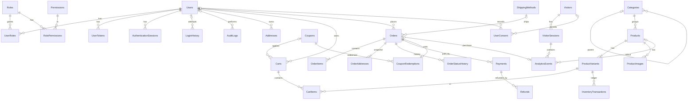

# Database design

SQL Server 2022, schema `dbo`, managed exclusively by Flyway
(`backend/src/main/resources/db/migration`). Hibernate runs with `ddl-auto=validate`, so entities
must match the migrations.

| Migration | Contents |
|---|---|
| `V1__create_identity_and_security_tables.sql` | Roles, Permissions, RolePermissions, Users, UserRoles, UserTokens, AuthenticationSessions, LoginHistory, AuditLogs + role/permission seed |
| `V2__create_catalog_tables.sql` | Categories, Products, ProductVariants, ProductImages |
| `V3__create_customer_cart_and_pricing_tables.sql` | Addresses, ShippingMethods, Coupons, Carts, CartItems + shipping seed |
| `V4__create_order_payment_inventory_tables.sql` | OrderNumberSeq, Orders, OrderAddresses, OrderItems, OrderStatusHistory, CouponRedemptions, Payments, Refunds, PaymentWebhookEvents, InventoryTransactions |
| `V5__create_analytics_and_consent_tables.sql` | Visitors, VisitorSessions, AnalyticsEvents, AnalyticsDailySummary, AnalyticsDailyProductStats, UserConsent |
| `V6__add_order_analytics_attribution.sql` | Consented visitor/session keys on Orders, for PURCHASE attribution |
| `db/seed/R__dev_seed_data.sql` | Demo catalog and coupons, loaded **only** by the `dev` profile |

Never edit an applied migration. Every change is a new `V<n>__description.sql`.

## Conventions

| Topic | Rule |
|---|---|
| Keys | `BIGINT IDENTITY(1,1)` clustered primary keys. Externally visible identifiers use a separate `UNIQUEIDENTIFIER PublicId` (users, sessions, carts) so sequential IDs are not exposed where enumeration matters. |
| Timestamps | `DATETIME2(3)`, UTC, defaults `SYSUTCDATETIME()`. `UpdatedAt` is maintained by JPA auditing. |
| Money | `DECIMAL(19,4)` + `CHAR(3)` ISO currency. Rounding to 2 decimals happens only at presentation and provider boundaries (half-even). |
| Text | `NVARCHAR` for human text, `VARCHAR` for codes, enums, hashes and SKUs. |
| Enums | `VARCHAR` + `CHECK` constraint (mapped with `@Enumerated(STRING)`). |
| Concurrency | `Version BIGINT` columns for JPA optimistic locking on mutable aggregates. |
| Deletes | Users, products and orders are never hard-deleted (deactivate / archive / cancel). `ON DELETE CASCADE` only for pure child rows (UserRoles, CartItems, ProductImages, OrderItems, OrderAddresses, UserTokens, sessions). |
| Secrets | Session, cart, reset and verification tokens are stored only as SHA-256 hashes. Passwords only as BCrypt hashes. No card data. |
| Names | `PK_`, `FK_`, `UQ_`, `UX_` (unique filtered index), `IX_`, `CK_`, `DF_` prefixes. |

## Entity relationships

## Integrity rules enforced in the database

* One active cart per user (`UX_Carts_ActiveUser`) and per anonymous cart token.
* Stock can never go negative (`CK_ProductVariants_Stock`); the ledger records `QuantityAfter`.
* `Orders.GrandTotal = Subtotal - DiscountTotal + ShippingTotal + TaxTotal`, `RefundedTotal <= GrandTotal`.
* Checkout idempotency: `UQ_Orders_User_IdempotencyKey`.
* One successful payment per order (`UX_Payments_OneSucceededPerOrder`); provider IDs unique.
* Webhooks processed once: `UQ_PaymentWebhookEvents_ProviderEvent`.
* One `PURCHASE` event per order (`UX_AnalyticsEvents_PurchaseOrder`); `PURCHASE`, `LOGIN`,
  `LOGOUT`, `REGISTER` must have `Source='SERVER'`, so clients can't forge them.
* Client event retries are ignored via `UQ_AnalyticsEvents_EventId`.
* `LoginHistory.FailureReason` is required for failures and forbidden for successes.

## Indexing for high-volume tables

`LoginHistory`: `(OccurredAt)`, `(UserId, OccurredAt)` filtered, `(Status, OccurredAt)`,
`(EmailHash, OccurredAt)` for repeated failures per submitted email, `(IpAddress, OccurredAt)`
filtered to failures, `(AuthSessionPublicId)` filtered.

`AnalyticsEvents`: `(EventType, OccurredAt) INCLUDE (VisitorId, VisitorSessionId, ProductId)` covers
funnel and distinct-visitor queries; `(OccurredAt)` for rollup and purge; `(ProductId, OccurredAt)`
and `(UserId, OccurredAt)` filtered; `(VisitorSessionId)` filtered. Columns such as `PagePath`,
`Referrer` and UTM fields are intentionally not indexed; traffic-source reports use
`VisitorSessions(StartedAt) INCLUDE (...)`.

Report queries always aggregate in SQL (`GROUP BY`, `COUNT(DISTINCT)`) over a bounded time range and
return small result sets or pages; they never stream raw events into application memory.

## Retention and archival

| Data | Retention | Mechanism |
|---|---|---|
| `AnalyticsEvents` | 13 months raw | Nightly job: roll up the previous UTC day into `AnalyticsDailySummary` / `AnalyticsDailyProductStats` (idempotent `MERGE`), then delete raw rows older than the cutoff in batches of 5,000 (`DELETE TOP (5000) ... WHERE OccurredAt < @cutoff`) to keep transactions and log growth small. |
| `VisitorSessions`, `Visitors` | 13 months after last activity | Same job, after dependent events are gone. |
| Daily rollups | Indefinite (aggregate, no personal data) | — |
| `LoginHistory` | 12 months | Nightly batched delete. Optional export to cold storage before delete. |
| `AuthenticationSessions` | 30 days after expiry/revocation | Nightly batched delete. |
| `UserTokens` | 7 days after expiry | Nightly batched delete. |
| `AuditLogs` | 24 months | Nightly batched delete or move to an archive database. |
| `PaymentWebhookEvents` | 90 days | Nightly batched delete. |
| Orders, payments, refunds | Per tax/accounting law (typically 7+ years) | Not purged; customer erasure anonymizes the user instead. |

Retention periods are configuration properties (`app.retention.*`) so they can be aligned with the
store's privacy policy. If event volume grows past tens of millions of rows, convert
`AnalyticsEvents` to monthly partitions on `OccurredAt` and replace batched deletes with
`TRUNCATE TABLE ... WITH (PARTITIONS (...))`. That requires changing the clustered key to
`(OccurredAt, Id)` and is deferred until needed.

## Database accounts (least privilege)

| Login | Used by | Rights |
|---|---|---|
| `sa` | Initial provisioning only | Never used by the app. Password from env, rotated after setup. |
| `ecommerce_migrator` | Flyway (on app start or as a separate job) | `db_ddladmin`, `db_datareader`, `db_datawriter` on the app database |
| `ecommerce_app` | Spring Boot at runtime | `db_datareader`, `db_datawriter`, `EXECUTE`; no DDL |
| `ecommerce_readonly` | Optional BI/reporting | `db_datareader` |

In production the app runs with `ecommerce_app` and Flyway runs with `ecommerce_migrator`. The script
that creates them is `infra/db/init.sql` (run by the `db-init` Compose service). The database also
has `READ_COMMITTED_SNAPSHOT` enabled so readers don't block writers.

## Backup and restore (summary)

Full backup daily, differential every 6 hours, log backups every 15 minutes (`FULL` recovery model).
Backups are encrypted, copied off-host and restore-tested monthly. Full procedure in [DEPLOYMENT.md](DEPLOYMENT.md).
